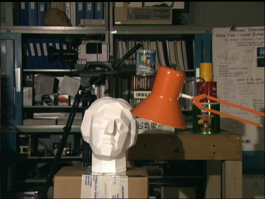
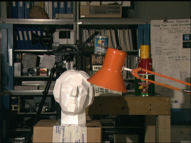
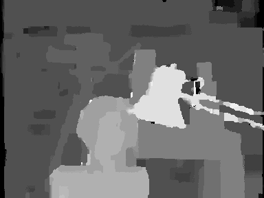
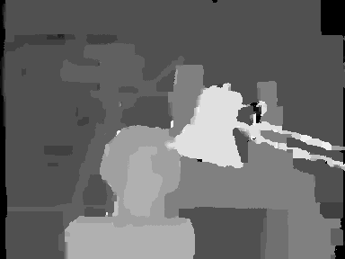
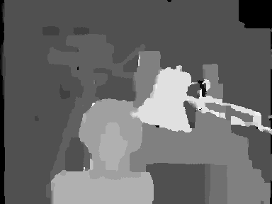
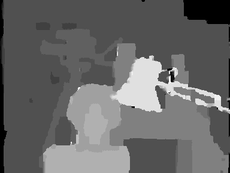
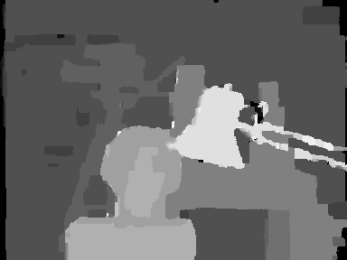

# Loopy Belief Propagation for Stereo Matching

## Overview

A C++ implementation of the **Loopy Belief Propagation** algorithm for stereo matching.

Given a pair of stereo images capturing the same scene from slightly different viewpoints, the program uses the left image as a reference to estimate a disparity map. Through an iterative message-passing process between neighboring pixels, the algorithm determines the most likely disparity value for each pixel. Intermediate disparity maps and their corresponding energy values are displayed to illustrate the algorithm's iterative process. Finally, the resulting disparity map is visualized and saved to disk.

## Features

- **Multiple Message Update Schedules:** Choose from six message update schedules.
- **Energy Evaluation:** Calculate and display the energy associated with the disparity map at each iteration.
- **Alternative Belief Computation Methods:** Choose between standard belief computation and incoming messages only.
- **Memory-Efficient Message Representation:** Each message is stored as a vector of `uint8_t` values, with each cost occupying only 8 bits (1 byte) in RAM.

## Algorithm Workflow

The following describes the main steps performed by the algorithm to generate the disparity map.

First, both images are loaded and converted to grayscale, and a Gaussian filter is applied to reduce image noise. The algorithm then computes and stores the *data cost* and *smoothness cost* values in memory and initializes the messages exchanged between neighboring pixels.

The iterative process then begins. At each iteration, messages are updated in the four directions using the selected message update schedule. Based on the updated messages, the algorithm computes the beliefs, updates the disparity map, and evaluates the corresponding energy.

The resulting disparity map is displayed and saved to disk.

## Requirements

- A C++ compiler.
- OpenCV library.

## Installation & Build

Compile the source code using a C++ compiler with OpenCV configured as a dependency. Make sure that the OpenCV include directories and libraries are properly configured and linked during compilation.

## Input Data

The program expects a stereo image pair with identical image dimensions:

- `left.png` — The left reference image.
- `right.png` — The corresponding right image.

Both images must be placed in the working directory before running the program.

## Configuration

The algorithm's parameters are configured through constants and variables defined directly in the source code.

### Parameter Reference

| Parameter | Description |
| --- | --- |
| `MESSAGE_UPDATE_SCHEDULE` | Selects the message update schedule used by the BP algorithm. |
| `BELIEF_COMPUTATION_METHOD` | Selects the method used to compute pixel beliefs. |
| `levels` | Number of disparity levels considered during stereo matching. |
| `iterations` | Number of iterations performed by the algorithm. |
| `lambda` | Weight (*λ*) controlling the contribution of the smoothness cost function. |
| `truncation` | Threshold (*T*) used by the smoothness cost function. |

### Message Update Schedules

The `MESSAGE_UPDATE_SCHEDULE` parameter selects one of six message update schedules.

| Value | Method |
| --- | --- |
| `1` | Synchronous |
| `2` | Bipartite |
| `3` | BP-M (Accelerated) |
| `4` | BP-S |
| `5` | ByRow1 |
| `6` | ByRow2 |

### Belief Computation Methods

The `BELIEF_COMPUTATION_METHOD` parameter selects how pixel beliefs are computed.

| Value | Method |
| --- | --- |
| `1` | Standard Belief |
| `2` | Messages Only |

The standard belief computation method includes the local cost, whereas the messages-only method considers only the incoming messages.

## Usage

Before running the program, make sure that `left.png` and `right.png` are placed in the working directory. Then, execute the compiled program using your preferred execution environment.

## Output

The program generates a disparity map named `disparity.png`, which is saved in the working directory. If a file with the same name already exists, it is overwritten.

During execution, intermediate disparity maps and their corresponding energy values are displayed to illustrate the progress of the algorithm.

## Results

The disparity maps below were generated using the classic **Tsukuba stereo pair**, showing the results of all six message update schedules.

### Input Stereo Pair

| Left Camera Image | Right Camera Image |
| :---: | :---: |
|  |  |

### Generated Disparity Maps

| Disparity Map | Message Update Schedule  |
| :---: | :---: |
|  | Synchronous |
|  | Bipartite |
|  | BP-M (Accelerated) |
|  | BP-S |
|  | ByRow1 |
|  | ByRow2 |

## Links

### Project Repository

- [Loopy Belief Propagation for Stereo Matching](https://github.com/aposb/loopy-belief-propagation-for-stereo-matching)

### Related Projects

- [Semi-Global Matching for Stereo Matching](https://github.com/aposb/semi-global-matching-for-stereo-matching)
- [Block Matching Algorithm for Stereo Matching](https://github.com/aposb/block-matching-algorithm-for-stereo-matching)

## License

This project is licensed under the MIT License. See the [LICENSE](LICENSE) file for details.
